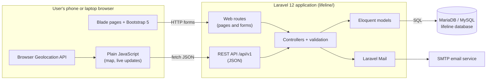

# LifeLine System Architecture

LifeLine is a single Laravel 12 application (a monolith) backed by one MariaDB/MySQL database. Phones and laptops use it through the browser; on a phone it can be installed to the home screen.

This is the target architecture. As of M1.2 only the database layer (migrations, models, seeders) exists; the web routes, `/api/v1`, map and mail parts are built in M1.3–M2.6.

## Layers

| Layer | Technology | Responsibility |
|---|---|---|
| Presentation | Blade templates, Bootstrap 5, plain JavaScript | Mobile-first screens from the team's design; frontend validation |
| Application | Laravel routes and controllers | Authentication, authorization by role, backend validation, business rules |
| API | `/api/v1` JSON endpoints | Data for the map, matching results, request tracking, and alerts, called by the app's own JavaScript |
| Data | Eloquent models, MariaDB | Storage with PK/FK, UNIQUE, CHECK constraints (see `docs/database/erd.md`) |
| External | OpenStreetMap, browser Geolocation, SMTP | Map tiles, user location (with permission), email notifications |

## Why this architecture

- One codebase and one database keep the project small enough for a student team to build, explain, and demo.
- The database enforces integrity rules itself, so invalid records are rejected even if application code has a bug.
- External services are free: OpenStreetMap needs no API key, Geolocation is built into browsers, and email uses standard SMTP.
