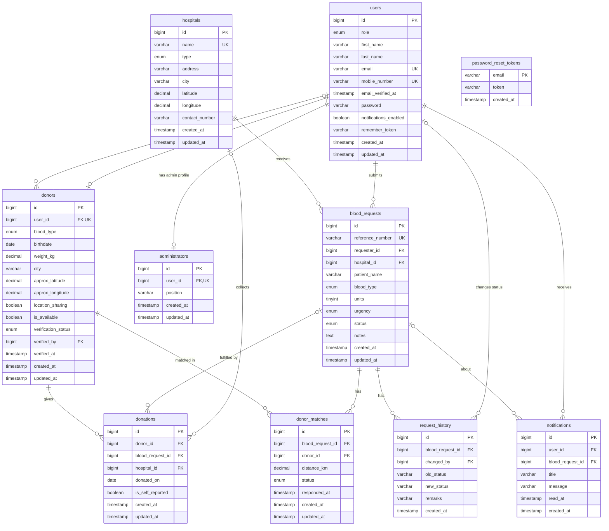

# LifeLine Entity Relationship Diagram

Source of truth: `lifeline/database/migrations/`. The test `ErdMatchesSchemaTest` fails if this diagram and the real tables drift apart.

## Normalization

The schema is in Third Normal Form (3NF):

- **1NF:** every column holds one value; no repeating groups (donation dates live in `donations`, not in a list on `donors`).
- **2NF:** every table has a single-column primary key (`id`, or `email` for `password_reset_tokens`), so no partial dependencies exist.
- **3NF:** no non-key column depends on another non-key column. Credentials exist only in `users`; donor and admin details live in 1:1 profile tables. A donor's last donation date is not stored — it is computed as `MAX(donations.donated_on)`.

## Data dictionary

### users — every account (donor, requester, admin)
| Column | Type | Rules |
|---|---|---|
| id | BIGINT UNSIGNED | PK, auto increment |
| role | ENUM('donor','requester','admin') | NOT NULL, default 'requester' |
| first_name | VARCHAR(100) | NOT NULL |
| last_name | VARCHAR(100) | NOT NULL |
| email | VARCHAR(255) | NOT NULL, UNIQUE |
| mobile_number | VARCHAR(20) | NOT NULL, UNIQUE |
| email_verified_at | TIMESTAMP | NULL until the email link is clicked |
| password | VARCHAR(255) | NOT NULL, bcrypt hash only |
| notifications_enabled | BOOLEAN | NOT NULL, default 1 |
| remember_token | VARCHAR(100) | NULL |
| created_at / updated_at | TIMESTAMP | NULL |

### password_reset_tokens — "Forgot password?" tokens
| Column | Type | Rules |
|---|---|---|
| email | VARCHAR(255) | PK |
| token | VARCHAR(255) | NOT NULL, hashed |
| created_at | TIMESTAMP | NULL |

### administrators — admin profile (1:1 with users)
| Column | Type | Rules |
|---|---|---|
| id | BIGINT UNSIGNED | PK |
| user_id | BIGINT UNSIGNED | NOT NULL, UNIQUE, FK → users.id ON DELETE CASCADE |
| position | VARCHAR(100) | NULL |
| created_at / updated_at | TIMESTAMP | NULL |

### hospitals — hospitals and blood banks (reference data managed by admins)
| Column | Type | Rules |
|---|---|---|
| id | BIGINT UNSIGNED | PK |
| name | VARCHAR(150) | NOT NULL, UNIQUE |
| type | ENUM('hospital','blood_bank') | NOT NULL, default 'hospital' |
| address | VARCHAR(255) | NOT NULL |
| city | VARCHAR(100) | NOT NULL |
| latitude / longitude | DECIMAL(9,6) | NOT NULL (public places, exact location allowed) |
| contact_number | VARCHAR(20) | NULL |
| created_at / updated_at | TIMESTAMP | NULL |

### donors — donor profile (1:1 with users)
| Column | Type | Rules |
|---|---|---|
| id | BIGINT UNSIGNED | PK |
| user_id | BIGINT UNSIGNED | NOT NULL, UNIQUE, FK → users.id ON DELETE CASCADE |
| blood_type | ENUM('A+','A-','B+','B-','AB+','AB-','O+','O-') | NOT NULL |
| birthdate | DATE | NOT NULL (age is computed, not stored) |
| weight_kg | DECIMAL(5,2) | NOT NULL, CHECK (weight_kg > 0) |
| city | VARCHAR(100) | NOT NULL |
| approx_latitude / approx_longitude | DECIMAL(5,2) | NULL; 2 decimals ≈ 1 km, so exact homes cannot be stored |
| location_sharing | BOOLEAN | NOT NULL, default 0 (opt-in) |
| is_available | BOOLEAN | NOT NULL, default 1 |
| verification_status | ENUM('pending','verified','rejected') | NOT NULL, default 'pending' |
| verified_by | BIGINT UNSIGNED | NULL, FK → users.id ON DELETE SET NULL |
| verified_at | TIMESTAMP | NULL |
| created_at / updated_at | TIMESTAMP | NULL |

Index: (blood_type, is_available) for donor searches.

### blood_requests — emergency blood requests
| Column | Type | Rules |
|---|---|---|
| id | BIGINT UNSIGNED | PK |
| reference_number | VARCHAR(16) | NOT NULL, UNIQUE, format LL-YYMMDD-XXXXXX |
| requester_id | BIGINT UNSIGNED | NOT NULL, FK → users.id (RESTRICT) |
| hospital_id | BIGINT UNSIGNED | NOT NULL, FK → hospitals.id (RESTRICT) |
| patient_name | VARCHAR(150) | NOT NULL, never shown on public tracking |
| blood_type | ENUM (8 types) | NOT NULL |
| units | TINYINT UNSIGNED | NOT NULL, CHECK (units BETWEEN 1 AND 10) |
| urgency | ENUM('critical','urgent') | NOT NULL |
| status | ENUM('open','donor_found','fulfilled','cancelled','expired') | NOT NULL, default 'open' |
| notes | TEXT | NULL |
| created_at / updated_at | TIMESTAMP | NULL |

Index: status.

### request_history — append-only log of status changes
| Column | Type | Rules |
|---|---|---|
| id | BIGINT UNSIGNED | PK |
| blood_request_id | BIGINT UNSIGNED | NOT NULL, FK → blood_requests.id (RESTRICT) |
| changed_by | BIGINT UNSIGNED | NULL (system), FK → users.id (RESTRICT) |
| old_status | VARCHAR(20) | NULL for the first entry |
| new_status | VARCHAR(20) | NOT NULL |
| remarks | VARCHAR(255) | NULL |
| created_at | TIMESTAMP | NOT NULL, default CURRENT_TIMESTAMP |

### donations — donation history (source of "last donation")
| Column | Type | Rules |
|---|---|---|
| id | BIGINT UNSIGNED | PK |
| donor_id | BIGINT UNSIGNED | NOT NULL, FK → donors.id (RESTRICT) |
| blood_request_id | BIGINT UNSIGNED | NULL, FK → blood_requests.id (RESTRICT) |
| hospital_id | BIGINT UNSIGNED | NULL, FK → hospitals.id (RESTRICT) |
| donated_on | DATE | NOT NULL |
| is_self_reported | BOOLEAN | NOT NULL, default 0 (1 = entered by donor at registration) |
| created_at / updated_at | TIMESTAMP | NULL |

Index: (donor_id, donated_on).

### donor_matches — potential donors found for a request
| Column | Type | Rules |
|---|---|---|
| id | BIGINT UNSIGNED | PK |
| blood_request_id | BIGINT UNSIGNED | NOT NULL, FK → blood_requests.id (RESTRICT) |
| donor_id | BIGINT UNSIGNED | NOT NULL, FK → donors.id (RESTRICT) |
| distance_km | DECIMAL(6,2) | NOT NULL, approximate |
| status | ENUM('notified','accepted','declined') | NOT NULL, default 'notified' |
| responded_at | TIMESTAMP | NULL |
| created_at / updated_at | TIMESTAMP | NULL |

Unique: (blood_request_id, donor_id) — a donor is matched once per request.

### notifications — in-app alerts
| Column | Type | Rules |
|---|---|---|
| id | BIGINT UNSIGNED | PK |
| user_id | BIGINT UNSIGNED | NOT NULL, FK → users.id ON DELETE CASCADE |
| blood_request_id | BIGINT UNSIGNED | NULL, FK → blood_requests.id ON DELETE SET NULL |
| title | VARCHAR(150) | NOT NULL |
| message | VARCHAR(500) | NOT NULL |
| read_at | TIMESTAMP | NULL = unread |
| created_at | TIMESTAMP | NOT NULL, default CURRENT_TIMESTAMP |

Index: (user_id, read_at) for the unread count.
