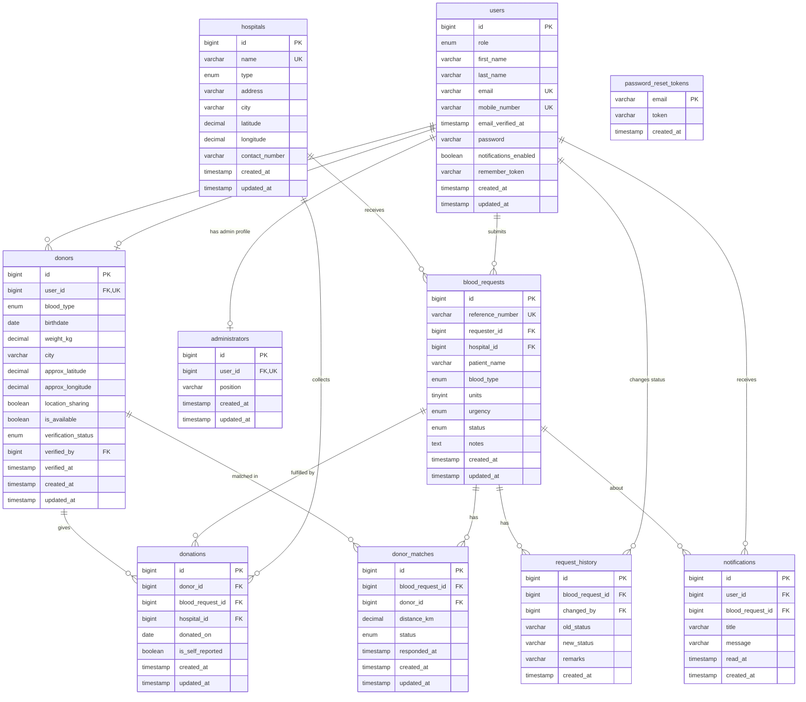
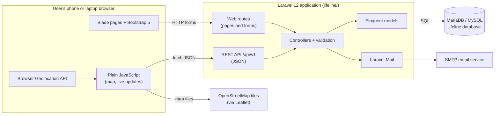

# M1.2 Architecture, ERD & SQL Database Implementation Plan

> **For agentic workers:** REQUIRED SUB-SKILL: Use superpowers:subagent-driven-development (recommended) or superpowers:executing-plans to implement this plan task-by-task. Steps use checkbox (`- [ ]`) syntax for tracking.

**Goal:** Create the Laravel 12 project and a normalized, constraint-checked MariaDB schema (10 tables) with sample data, an ERD, an architecture diagram, and documented SQL queries.

**Architecture:** One Laravel 12 app in `lifeline/` (monolith). Laravel migrations are the single source of truth for the schema; `docs/database/lifeline_schema.sql` is exported from them, never hand-edited. Database rules (UNIQUE, FOREIGN KEY, CHECK, ENUM) are enforced by MariaDB itself and proven by PHPUnit tests that run against a real MariaDB test database.

**Tech Stack:** PHP 8.2 (XAMPP), Laravel 12, MariaDB 10.4 (XAMPP), PHPUnit, Mermaid (diagrams in Markdown).

## Global Constraints

- Keep the code simple: Laravel built-ins only, no extra Composer packages, no soft deletes, no UUIDs.
- Laravel app lives in `lifeline/`; documentation lives in `docs/` at the repository root.
- Database connection driver: `mariadb`. App database `lifeline`, test database `lifeline_test`, MySQL user `lifeline` (not `root`).
- The DB password is generated locally and stored only in `lifeline/.env` (gitignored). Never print it, commit it, or put it in `phpunit.xml`.
- Sessions and cache use `file`; queue uses `sync`. No `sessions`, `cache`, `cache_locks`, `jobs`, `job_batches`, `failed_jobs` tables.
- Blood types: `A+`, `A-`, `B+`, `B-`, `AB+`, `AB-`, `O+`, `O-`.
- Request statuses: `open`, `donor_found`, `fulfilled`, `cancelled`, `expired`. Urgency: `critical`, `urgent`.
- Units per request: 1–10 (CHECK). Donor weight > 0 (CHECK).
- Donor location columns hold 2 decimal places only (about 1 km) — exact home locations cannot be stored (DEC-004).
- Reference number format: `LL-YYMMDD-XXXXXX`, suffix from `ABCDEFGHJKLMNPQRSTUVWXYZ23456789`; UNIQUE in the database (DEC-006).
- No government ID storage (DEC-009).
- Sample hospitals are clearly fake (`Sample …`) until the team supplies verified names (DEC-010).
- Every migration has a working `down()`.
- All commands below run from the repository root `D:\ITE-18_LifeLine` unless the step says `lifeline/`. They work in Git Bash and PowerShell.

---

## File Structure

| Path | Responsibility |
|---|---|
| `lifeline/` | Laravel 12 application (created by Composer) |
| `lifeline/.env`, `lifeline/.env.example` | DB, session, cache, queue settings |
| `lifeline/phpunit.xml` | Points tests at `lifeline_test` |
| `lifeline/database/migrations/0001_01_01_000000_create_users_table.php` | `users`, `password_reset_tokens` |
| `lifeline/database/migrations/2026_11_13_000001_create_administrators_table.php` | `administrators` |
| `lifeline/database/migrations/2026_11_13_000002_create_hospitals_table.php` | `hospitals` |
| `lifeline/database/migrations/2026_11_13_000003_create_donors_table.php` | `donors` |
| `lifeline/database/migrations/2026_11_13_000004_create_blood_requests_table.php` | `blood_requests` |
| `lifeline/database/migrations/2026_11_13_000005_create_request_history_table.php` | `request_history` |
| `lifeline/database/migrations/2026_11_13_000006_create_donations_table.php` | `donations` |
| `lifeline/database/migrations/2026_11_13_000007_create_donor_matches_table.php` | `donor_matches` |
| `lifeline/database/migrations/2026_11_13_000008_create_notifications_table.php` | `notifications` |
| `lifeline/app/Models/*.php` | One Eloquent model per table |
| `lifeline/database/factories/*.php` | Sample-data factories |
| `lifeline/database/seeders/DatabaseSeeder.php` | Sample records |
| `lifeline/tests/Feature/Database/*.php` | Schema, constraint, seeder, and ERD tests |
| `docs/architecture.md` | Architecture diagram |
| `docs/database/erd.md` | ERD + data dictionary |
| `docs/database/lifeline_schema.sql` | Exported schema (generated) |
| `docs/database/crud_queries.sql` | Documented SQL CRUD examples |

---

### Task 1: Laravel project and MariaDB connection

**Files:**
- Create: `lifeline/` (Composer)
- Modify: `lifeline/.env`, `lifeline/.env.example`, `lifeline/phpunit.xml`, `lifeline/database/migrations/0001_01_01_000000_create_users_table.php`
- Delete: `lifeline/database/migrations/0001_01_01_000001_create_cache_table.php`, `lifeline/database/migrations/0001_01_01_000002_create_jobs_table.php`, `lifeline/database/database.sqlite`
- Test: `lifeline/tests/Feature/Database/DatabaseSetupTest.php`

**Interfaces:**
- Produces: working `lifeline/` app connected to `lifeline` (app) and `lifeline_test` (tests) via driver `mariadb`.

- [ ] **Step 1: Confirm MariaDB is running**

Run: `C:/xampp/mysql/bin/mysql.exe -u root -e "SELECT VERSION();"`
Expected: a version line containing `10.4`. If it fails, ask the human to start MySQL in the XAMPP Control Panel and stop.

- [ ] **Step 2: Create the Laravel 12 project**

Run: `composer create-project laravel/laravel:^12.0 lifeline`
Expected: ends with `Application ready` (or similar) and `lifeline/artisan` exists.

- [ ] **Step 3: Configure `lifeline/.env` and `lifeline/.env.example`**

In both files, set these keys (replace the existing `DB_*` block, including commented `# DB_HOST=` lines; edit the other keys in place). Leave `DB_PASSWORD=` empty for now — Step 4 fills it in `.env` only.

```dotenv
APP_NAME=LifeLine
APP_URL=http://127.0.0.1:8000

DB_CONNECTION=mariadb
DB_HOST=127.0.0.1
DB_PORT=3306
DB_DATABASE=lifeline
DB_USERNAME=lifeline
DB_PASSWORD=

SESSION_DRIVER=file
CACHE_STORE=file
QUEUE_CONNECTION=sync
```

- [ ] **Step 4: Create databases and the least-privilege user (password never printed)**

Run this in Git Bash from the repo root, as one command. It generates a random password, creates both databases and the `lifeline` user, and writes the password only into `lifeline/.env`:

```bash
PW="$(php -r 'echo bin2hex(random_bytes(12));')" && \
printf "CREATE DATABASE IF NOT EXISTS lifeline CHARACTER SET utf8mb4 COLLATE utf8mb4_unicode_ci;
CREATE DATABASE IF NOT EXISTS lifeline_test CHARACTER SET utf8mb4 COLLATE utf8mb4_unicode_ci;
CREATE USER IF NOT EXISTS 'lifeline'@'localhost' IDENTIFIED BY '%s';
GRANT ALL PRIVILEGES ON lifeline.* TO 'lifeline'@'localhost';
GRANT ALL PRIVILEGES ON lifeline_test.* TO 'lifeline'@'localhost';
FLUSH PRIVILEGES;\n" "$PW" | C:/xampp/mysql/bin/mysql.exe -u root && \
sed -i "s/^DB_PASSWORD=.*/DB_PASSWORD=$PW/" lifeline/.env && unset PW && echo "database user ready"
```

Expected: `database user ready`. If the `lifeline` user already existed from an earlier attempt, run `DROP USER 'lifeline'@'localhost';` as root first, then rerun.

- [ ] **Step 5: Check the connection**

Run (in `lifeline/`): `php artisan db:show`
Expected: a table showing `MariaDB`, database `lifeline`, user `lifeline`, no connection error.

- [ ] **Step 6: Point PHPUnit at the test database**

In `lifeline/phpunit.xml`, inside `<php>`, make these two lines exactly (uncomment them if commented):

```xml
<env name="DB_CONNECTION" value="mariadb"/>
<env name="DB_DATABASE" value="lifeline_test"/>
```

Leave the other `<env>` lines as Laravel created them. The password is read from `.env`.

- [ ] **Step 7: Write the failing test**

Create `lifeline/tests/Feature/Database/DatabaseSetupTest.php`:

```php
<?php

namespace Tests\Feature\Database;

use Illuminate\Foundation\Testing\RefreshDatabase;
use Illuminate\Support\Facades\DB;
use Illuminate\Support\Facades\Schema;
use Tests\TestCase;

class DatabaseSetupTest extends TestCase
{
    use RefreshDatabase;

    public function test_uses_mariadb_test_database(): void
    {
        $this->assertSame('mariadb', DB::connection()->getDriverName());
        $this->assertSame('lifeline_test', DB::connection()->getDatabaseName());
    }

    public function test_only_needed_framework_tables_exist(): void
    {
        $this->assertTrue(Schema::hasTable('users'));
        $this->assertTrue(Schema::hasTable('password_reset_tokens'));

        foreach (['sessions', 'cache', 'cache_locks', 'jobs', 'job_batches', 'failed_jobs'] as $table) {
            $this->assertFalse(Schema::hasTable($table), "{$table} should not exist");
        }
    }
}
```

- [ ] **Step 8: Run test to verify it fails**

Run (in `lifeline/`): `php artisan test --filter=DatabaseSetupTest`
Expected: FAIL — `sessions should not exist` (Laravel's default migrations still create it).

- [ ] **Step 9: Remove unused framework tables**

Delete `lifeline/database/migrations/0001_01_01_000001_create_cache_table.php` and `lifeline/database/migrations/0001_01_01_000002_create_jobs_table.php`. Delete `lifeline/database/database.sqlite` if it exists.

Replace `lifeline/database/migrations/0001_01_01_000000_create_users_table.php` with the version below. (It also adds LifeLine's user columns; Task 2 tests them.)

```php
<?php

use Illuminate\Database\Migrations\Migration;
use Illuminate\Database\Schema\Blueprint;
use Illuminate\Support\Facades\Schema;

return new class extends Migration
{
    public function up(): void
    {
        Schema::create('users', function (Blueprint $table) {
            $table->id();
            $table->enum('role', ['donor', 'requester', 'admin'])->default('requester');
            $table->string('first_name', 100);
            $table->string('last_name', 100);
            $table->string('email')->unique();
            $table->string('mobile_number', 20)->unique();
            $table->timestamp('email_verified_at')->nullable();
            $table->string('password');
            $table->boolean('notifications_enabled')->default(true);
            $table->rememberToken();
            $table->timestamps();
        });

        Schema::create('password_reset_tokens', function (Blueprint $table) {
            $table->string('email')->primary();
            $table->string('token');
            $table->timestamp('created_at')->nullable();
        });
    }

    public function down(): void
    {
        Schema::dropIfExists('password_reset_tokens');
        Schema::dropIfExists('users');
    }
};
```

- [ ] **Step 10: Run tests to verify they pass**

Run (in `lifeline/`): `php artisan migrate:fresh` then `php artisan test --filter=DatabaseSetupTest`
Expected: migrate prints `DONE` for `0001_01_01_000000_create_users_table`; tests PASS (2 tests).

- [ ] **Step 11: Commit**

```bash
git add lifeline
git commit -m "feat(db): create Laravel 12 app on MariaDB with lean framework tables"
```

Before committing, run `git status --short lifeline/.env` — it must print nothing (ignored). If it lists `.env`, stop and fix `.gitignore`.

---

### Task 2: users, administrators, hospitals

**Files:**
- Create: `lifeline/database/migrations/2026_11_13_000001_create_administrators_table.php`, `lifeline/database/migrations/2026_11_13_000002_create_hospitals_table.php`, `lifeline/tests/Feature/Database/InsertsRows.php`
- Test: `lifeline/tests/Feature/Database/UsersAndHospitalsTest.php`

**Interfaces:**
- Consumes: `users` table from Task 1.
- Produces: trait `Tests\Feature\Database\InsertsRows` with `insertUser(array $overrides = []): int`, `insertHospital(array $overrides = []): int`, `insertDonor(array $overrides = []): int`, `insertBloodRequest(array $overrides = []): int` — later tasks use all four.

- [ ] **Step 1: Create the test helper trait**

Create `lifeline/tests/Feature/Database/InsertsRows.php` (complete; `insertDonor` and `insertBloodRequest` are used from Tasks 3–5):

```php
<?php

namespace Tests\Feature\Database;

use Illuminate\Support\Facades\DB;

trait InsertsRows
{
    private int $rowCounter = 0;

    protected function insertUser(array $overrides = []): int
    {
        $this->rowCounter++;

        return DB::table('users')->insertGetId(array_merge([
            'role' => 'requester',
            'first_name' => 'Test',
            'last_name' => 'User',
            'email' => "user{$this->rowCounter}@example.test",
            'mobile_number' => '0917'.str_pad((string) $this->rowCounter, 7, '0', STR_PAD_LEFT),
            'password' => bcrypt('password'),
            'created_at' => now(),
            'updated_at' => now(),
        ], $overrides));
    }

    protected function insertHospital(array $overrides = []): int
    {
        $this->rowCounter++;

        return DB::table('hospitals')->insertGetId(array_merge([
            'name' => "Sample Hospital {$this->rowCounter}",
            'type' => 'hospital',
            'address' => 'Sample address',
            'city' => 'Butuan City',
            'latitude' => 8.947500,
            'longitude' => 125.540600,
            'created_at' => now(),
            'updated_at' => now(),
        ], $overrides));
    }

    protected function insertDonor(array $overrides = []): int
    {
        $userId = $overrides['user_id'] ?? $this->insertUser(['role' => 'donor']);

        return DB::table('donors')->insertGetId(array_merge([
            'user_id' => $userId,
            'blood_type' => 'O+',
            'birthdate' => '2000-01-15',
            'weight_kg' => 60,
            'city' => 'Butuan City',
            'approx_latitude' => 8.95,
            'approx_longitude' => 125.54,
            'created_at' => now(),
            'updated_at' => now(),
        ], $overrides));
    }

    protected function insertBloodRequest(array $overrides = []): int
    {
        $this->rowCounter++;
        $reference = sprintf('LL-261113-TST%03d', $this->rowCounter);

        return DB::table('blood_requests')->insertGetId(array_merge([
            'reference_number' => $reference,
            'requester_id' => $overrides['requester_id'] ?? $this->insertUser(),
            'hospital_id' => $overrides['hospital_id'] ?? $this->insertHospital(),
            'patient_name' => 'Test Patient',
            'blood_type' => 'O+',
            'units' => 2,
            'urgency' => 'critical',
            'created_at' => now(),
            'updated_at' => now(),
        ], $overrides));
    }
}
```

- [ ] **Step 2: Write the failing tests**

Create `lifeline/tests/Feature/Database/UsersAndHospitalsTest.php`:

```php
<?php

namespace Tests\Feature\Database;

use Illuminate\Database\QueryException;
use Illuminate\Database\UniqueConstraintViolationException;
use Illuminate\Foundation\Testing\RefreshDatabase;
use Illuminate\Support\Facades\DB;
use Tests\TestCase;

class UsersAndHospitalsTest extends TestCase
{
    use InsertsRows;
    use RefreshDatabase;

    public function test_duplicate_email_is_rejected(): void
    {
        $this->insertUser(['email' => 'juan@example.test']);

        $this->expectException(UniqueConstraintViolationException::class);
        $this->insertUser(['email' => 'juan@example.test']);
    }

    public function test_duplicate_mobile_number_is_rejected(): void
    {
        $this->insertUser(['mobile_number' => '09171234567']);

        $this->expectException(UniqueConstraintViolationException::class);
        $this->insertUser(['mobile_number' => '09171234567']);
    }

    public function test_invalid_role_is_rejected(): void
    {
        $this->expectException(QueryException::class);
        $this->expectExceptionMessage("column 'role'");
        $this->insertUser(['role' => 'superuser']);
    }

    public function test_user_has_at_most_one_administrator_profile(): void
    {
        $userId = $this->insertUser(['role' => 'admin']);
        DB::table('administrators')->insert(['user_id' => $userId, 'position' => 'Admin']);

        $this->expectException(UniqueConstraintViolationException::class);
        DB::table('administrators')->insert(['user_id' => $userId, 'position' => 'Admin']);
    }

    public function test_administrator_requires_existing_user(): void
    {
        $this->expectException(QueryException::class);
        $this->expectExceptionMessage('foreign key constraint fails');
        DB::table('administrators')->insert(['user_id' => 999999, 'position' => 'Admin']);
    }

    public function test_duplicate_hospital_name_is_rejected(): void
    {
        $this->insertHospital(['name' => 'Sample General Hospital']);

        $this->expectException(UniqueConstraintViolationException::class);
        $this->insertHospital(['name' => 'Sample General Hospital']);
    }

    public function test_invalid_hospital_type_is_rejected(): void
    {
        $this->expectException(QueryException::class);
        $this->expectExceptionMessage("column 'type'");
        $this->insertHospital(['type' => 'clinic']);
    }
}
```

- [ ] **Step 3: Run tests to verify they fail**

Run (in `lifeline/`): `php artisan test --filter=UsersAndHospitalsTest`
Expected: the email, mobile, and role tests PASS (Task 1 already created `users`); the administrator and hospital tests FAIL with `Table 'lifeline_test.administrators' doesn't exist` / `hospitals' doesn't exist`.

- [ ] **Step 4: Create the administrators migration**

Create `lifeline/database/migrations/2026_11_13_000001_create_administrators_table.php`:

```php
<?php

use Illuminate\Database\Migrations\Migration;
use Illuminate\Database\Schema\Blueprint;
use Illuminate\Support\Facades\Schema;

return new class extends Migration
{
    public function up(): void
    {
        Schema::create('administrators', function (Blueprint $table) {
            $table->id();
            $table->foreignId('user_id')->unique()->constrained()->cascadeOnDelete();
            $table->string('position', 100)->nullable();
            $table->timestamps();
        });
    }

    public function down(): void
    {
        Schema::dropIfExists('administrators');
    }
};
```

- [ ] **Step 5: Create the hospitals migration**

Create `lifeline/database/migrations/2026_11_13_000002_create_hospitals_table.php`:

```php
<?php

use Illuminate\Database\Migrations\Migration;
use Illuminate\Database\Schema\Blueprint;
use Illuminate\Support\Facades\Schema;

return new class extends Migration
{
    public function up(): void
    {
        Schema::create('hospitals', function (Blueprint $table) {
            $table->id();
            $table->string('name', 150)->unique();
            $table->enum('type', ['hospital', 'blood_bank'])->default('hospital');
            $table->string('address');
            $table->string('city', 100);
            $table->decimal('latitude', 9, 6);
            $table->decimal('longitude', 9, 6);
            $table->string('contact_number', 20)->nullable();
            $table->timestamps();
        });
    }

    public function down(): void
    {
        Schema::dropIfExists('hospitals');
    }
};
```

- [ ] **Step 6: Run tests to verify they pass**

Run (in `lifeline/`): `php artisan test --filter=UsersAndHospitalsTest`
Expected: PASS (7 tests).

- [ ] **Step 7: Commit**

```bash
git add lifeline/database/migrations lifeline/tests/Feature/Database
git commit -m "feat(db): add administrators and hospitals tables with constraint tests"
```

---

### Task 3: donors

**Files:**
- Create: `lifeline/database/migrations/2026_11_13_000003_create_donors_table.php`
- Test: `lifeline/tests/Feature/Database/DonorsTableTest.php`

**Interfaces:**
- Consumes: `InsertsRows::insertUser`, `InsertsRows::insertDonor`.
- Produces: `donors` table; CHECK constraint named `chk_donors_weight`.

- [ ] **Step 1: Write the failing tests**

Create `lifeline/tests/Feature/Database/DonorsTableTest.php`:

```php
<?php

namespace Tests\Feature\Database;

use Illuminate\Database\QueryException;
use Illuminate\Database\UniqueConstraintViolationException;
use Illuminate\Foundation\Testing\RefreshDatabase;
use Illuminate\Support\Facades\DB;
use Tests\TestCase;

class DonorsTableTest extends TestCase
{
    use InsertsRows;
    use RefreshDatabase;

    public function test_invalid_blood_type_is_rejected(): void
    {
        $this->expectException(QueryException::class);
        $this->expectExceptionMessage("column 'blood_type'");
        $this->insertDonor(['blood_type' => 'C+']);
    }

    public function test_weight_must_be_positive(): void
    {
        $this->expectException(QueryException::class);
        $this->expectExceptionMessage('chk_donors_weight');
        $this->insertDonor(['weight_kg' => 0]);
    }

    public function test_user_has_at_most_one_donor_profile(): void
    {
        $userId = $this->insertUser(['role' => 'donor']);
        $this->insertDonor(['user_id' => $userId]);

        $this->expectException(UniqueConstraintViolationException::class);
        $this->insertDonor(['user_id' => $userId]);
    }

    public function test_exact_coordinates_are_rounded_to_about_one_kilometre(): void
    {
        $donorId = $this->insertDonor(['approx_latitude' => 8.947412, 'approx_longitude' => 125.540617]);

        $row = DB::table('donors')->where('id', $donorId)->first();
        $this->assertSame('8.95', (string) $row->approx_latitude);
        $this->assertSame('125.54', (string) $row->approx_longitude);
    }

    public function test_new_donor_defaults(): void
    {
        $donorId = $this->insertDonor();

        $row = DB::table('donors')->where('id', $donorId)->first();
        $this->assertSame('pending', $row->verification_status);
        $this->assertEquals(1, $row->is_available);
        $this->assertEquals(0, $row->location_sharing);
    }

    public function test_deleting_user_removes_donor_profile(): void
    {
        $userId = $this->insertUser(['role' => 'donor']);
        $this->insertDonor(['user_id' => $userId]);

        DB::table('users')->where('id', $userId)->delete();

        $this->assertSame(0, DB::table('donors')->where('user_id', $userId)->count());
    }
}
```

- [ ] **Step 2: Run tests to verify they fail**

Run (in `lifeline/`): `php artisan test --filter=DonorsTableTest`
Expected: FAIL — `Table 'lifeline_test.donors' doesn't exist`.

- [ ] **Step 3: Create the donors migration**

Create `lifeline/database/migrations/2026_11_13_000003_create_donors_table.php`:

```php
<?php

use Illuminate\Database\Migrations\Migration;
use Illuminate\Database\Schema\Blueprint;
use Illuminate\Support\Facades\DB;
use Illuminate\Support\Facades\Schema;

return new class extends Migration
{
    public function up(): void
    {
        Schema::create('donors', function (Blueprint $table) {
            $table->id();
            $table->foreignId('user_id')->unique()->constrained()->cascadeOnDelete();
            $table->enum('blood_type', ['A+', 'A-', 'B+', 'B-', 'AB+', 'AB-', 'O+', 'O-']);
            $table->date('birthdate');
            $table->decimal('weight_kg', 5, 2);
            $table->string('city', 100);
            // 2 decimal places = about 1 km: exact home locations cannot be stored (DEC-004).
            $table->decimal('approx_latitude', 5, 2)->nullable();
            $table->decimal('approx_longitude', 5, 2)->nullable();
            $table->boolean('location_sharing')->default(false);
            $table->boolean('is_available')->default(true);
            $table->enum('verification_status', ['pending', 'verified', 'rejected'])->default('pending');
            $table->foreignId('verified_by')->nullable()->constrained('users')->nullOnDelete();
            $table->timestamp('verified_at')->nullable();
            $table->timestamps();

            $table->index(['blood_type', 'is_available']);
        });

        DB::statement('ALTER TABLE donors ADD CONSTRAINT chk_donors_weight CHECK (weight_kg > 0)');
    }

    public function down(): void
    {
        Schema::dropIfExists('donors');
    }
};
```

- [ ] **Step 4: Run tests to verify they pass**

Run (in `lifeline/`): `php artisan test --filter=DonorsTableTest`
Expected: PASS (6 tests). MariaDB rounds extra decimal places on DECIMAL columns with a note, not an error. If your server rejects the value instead, the privacy rule still holds: change that test to expect a `QueryException`, and record in `genOS/brain/systems/app/DonorMap.md` that the app must round coordinates before saving.

- [ ] **Step 5: Commit**

```bash
git add lifeline/database/migrations lifeline/tests/Feature/Database
git commit -m "feat(db): add donors table with blood type, weight check and approximate location"
```

---

### Task 4: blood_requests and request_history

**Files:**
- Create: `lifeline/database/migrations/2026_11_13_000004_create_blood_requests_table.php`, `lifeline/database/migrations/2026_11_13_000005_create_request_history_table.php`
- Test: `lifeline/tests/Feature/Database/BloodRequestsTableTest.php`

**Interfaces:**
- Consumes: `InsertsRows::insertUser`, `insertHospital`, `insertBloodRequest`.
- Produces: `blood_requests` (UNIQUE `reference_number`, CHECK `chk_blood_requests_units`) and `request_history`.

- [ ] **Step 1: Write the failing tests**

Create `lifeline/tests/Feature/Database/BloodRequestsTableTest.php`:

```php
<?php

namespace Tests\Feature\Database;

use Illuminate\Database\QueryException;
use Illuminate\Database\UniqueConstraintViolationException;
use Illuminate\Foundation\Testing\RefreshDatabase;
use Illuminate\Support\Facades\DB;
use Tests\TestCase;

class BloodRequestsTableTest extends TestCase
{
    use InsertsRows;
    use RefreshDatabase;

    public function test_duplicate_reference_number_is_rejected_by_database(): void
    {
        $this->insertBloodRequest(['reference_number' => 'LL-261113-ABC234']);

        $this->expectException(UniqueConstraintViolationException::class);
        $this->insertBloodRequest(['reference_number' => 'LL-261113-ABC234']);
    }

    public function test_units_between_one_and_ten_are_accepted(): void
    {
        $this->insertBloodRequest(['units' => 1]);
        $this->insertBloodRequest(['units' => 10]);

        $this->assertSame(2, DB::table('blood_requests')->count());
    }

    public function test_zero_units_are_rejected(): void
    {
        $this->expectException(QueryException::class);
        $this->expectExceptionMessage('chk_blood_requests_units');
        $this->insertBloodRequest(['units' => 0]);
    }

    public function test_more_than_ten_units_are_rejected(): void
    {
        $this->expectException(QueryException::class);
        $this->expectExceptionMessage('chk_blood_requests_units');
        $this->insertBloodRequest(['units' => 11]);
    }

    public function test_invalid_status_is_rejected(): void
    {
        $this->expectException(QueryException::class);
        $this->expectExceptionMessage("column 'status'");
        $this->insertBloodRequest(['status' => 'approved']);
    }

    public function test_new_request_is_open(): void
    {
        $id = $this->insertBloodRequest();

        $this->assertSame('open', DB::table('blood_requests')->where('id', $id)->value('status'));
    }

    public function test_request_requires_existing_hospital(): void
    {
        $this->expectException(QueryException::class);
        $this->expectExceptionMessage('foreign key constraint fails');
        $this->insertBloodRequest(['hospital_id' => 999999]);
    }

    public function test_request_with_history_cannot_be_deleted(): void
    {
        $id = $this->insertBloodRequest();
        DB::table('request_history')->insert([
            'blood_request_id' => $id,
            'old_status' => null,
            'new_status' => 'open',
            'remarks' => 'Request submitted',
        ]);

        $this->expectException(QueryException::class);
        $this->expectExceptionMessage('foreign key constraint fails');
        DB::table('blood_requests')->where('id', $id)->delete();
    }

    public function test_requester_with_requests_cannot_be_deleted(): void
    {
        $userId = $this->insertUser();
        $this->insertBloodRequest(['requester_id' => $userId]);

        $this->expectException(QueryException::class);
        $this->expectExceptionMessage('foreign key constraint fails');
        DB::table('users')->where('id', $userId)->delete();
    }

    public function test_history_rows_get_a_timestamp_automatically(): void
    {
        $id = $this->insertBloodRequest();
        DB::table('request_history')->insert(['blood_request_id' => $id, 'new_status' => 'open']);

        $this->assertNotNull(DB::table('request_history')->value('created_at'));
    }
}
```

- [ ] **Step 2: Run tests to verify they fail**

Run (in `lifeline/`): `php artisan test --filter=BloodRequestsTableTest`
Expected: FAIL — `Table 'lifeline_test.blood_requests' doesn't exist`.

- [ ] **Step 3: Create the blood_requests migration**

Create `lifeline/database/migrations/2026_11_13_000004_create_blood_requests_table.php`:

```php
<?php

use Illuminate\Database\Migrations\Migration;
use Illuminate\Database\Schema\Blueprint;
use Illuminate\Support\Facades\DB;
use Illuminate\Support\Facades\Schema;

return new class extends Migration
{
    public function up(): void
    {
        Schema::create('blood_requests', function (Blueprint $table) {
            $table->id();
            // Format LL-YYMMDD-XXXXXX; UNIQUE is the final guard against duplicates (DEC-006).
            $table->string('reference_number', 16)->unique();
            $table->foreignId('requester_id')->constrained('users');
            $table->foreignId('hospital_id')->constrained();
            $table->string('patient_name', 150);
            $table->enum('blood_type', ['A+', 'A-', 'B+', 'B-', 'AB+', 'AB-', 'O+', 'O-']);
            $table->unsignedTinyInteger('units');
            $table->enum('urgency', ['critical', 'urgent']);
            $table->enum('status', ['open', 'donor_found', 'fulfilled', 'cancelled', 'expired'])->default('open');
            $table->text('notes')->nullable();
            $table->timestamps();

            $table->index('status');
        });

        DB::statement('ALTER TABLE blood_requests ADD CONSTRAINT chk_blood_requests_units CHECK (units BETWEEN 1 AND 10)');
    }

    public function down(): void
    {
        Schema::dropIfExists('blood_requests');
    }
};
```

- [ ] **Step 4: Create the request_history migration**

Create `lifeline/database/migrations/2026_11_13_000005_create_request_history_table.php`:

```php
<?php

use Illuminate\Database\Migrations\Migration;
use Illuminate\Database\Schema\Blueprint;
use Illuminate\Support\Facades\Schema;

return new class extends Migration
{
    public function up(): void
    {
        Schema::create('request_history', function (Blueprint $table) {
            $table->id();
            $table->foreignId('blood_request_id')->constrained();
            $table->foreignId('changed_by')->nullable()->constrained('users');
            $table->string('old_status', 20)->nullable();
            $table->string('new_status', 20);
            $table->string('remarks')->nullable();
            // History is append-only, so there is no updated_at.
            $table->timestamp('created_at')->useCurrent();
        });
    }

    public function down(): void
    {
        Schema::dropIfExists('request_history');
    }
};
```

- [ ] **Step 5: Run tests to verify they pass**

Run (in `lifeline/`): `php artisan test --filter=BloodRequestsTableTest`
Expected: PASS (10 tests).

- [ ] **Step 6: Commit**

```bash
git add lifeline/database/migrations lifeline/tests/Feature/Database
git commit -m "feat(db): add blood_requests with unique reference numbers and request_history"
```

---

### Task 5: donations, donor_matches, notifications

**Files:**
- Create: `lifeline/database/migrations/2026_11_13_000006_create_donations_table.php`, `lifeline/database/migrations/2026_11_13_000007_create_donor_matches_table.php`, `lifeline/database/migrations/2026_11_13_000008_create_notifications_table.php`
- Test: `lifeline/tests/Feature/Database/MatchesDonationsNotificationsTest.php`

**Interfaces:**
- Consumes: `InsertsRows::insertUser`, `insertDonor`, `insertBloodRequest`, `insertHospital`.
- Produces: `donations`, `donor_matches` (UNIQUE `blood_request_id`+`donor_id`), `notifications`.

- [ ] **Step 1: Write the failing tests**

Create `lifeline/tests/Feature/Database/MatchesDonationsNotificationsTest.php`:

```php
<?php

namespace Tests\Feature\Database;

use Illuminate\Database\QueryException;
use Illuminate\Database\UniqueConstraintViolationException;
use Illuminate\Foundation\Testing\RefreshDatabase;
use Illuminate\Support\Facades\DB;
use Tests\TestCase;

class MatchesDonationsNotificationsTest extends TestCase
{
    use InsertsRows;
    use RefreshDatabase;

    public function test_donor_is_matched_at_most_once_per_request(): void
    {
        $requestId = $this->insertBloodRequest();
        $donorId = $this->insertDonor();
        $match = ['blood_request_id' => $requestId, 'donor_id' => $donorId, 'distance_km' => 1.2];
        DB::table('donor_matches')->insert($match);

        $this->expectException(UniqueConstraintViolationException::class);
        DB::table('donor_matches')->insert($match);
    }

    public function test_new_match_is_notified(): void
    {
        DB::table('donor_matches')->insert([
            'blood_request_id' => $this->insertBloodRequest(),
            'donor_id' => $this->insertDonor(),
            'distance_km' => 3.5,
        ]);

        $this->assertSame('notified', DB::table('donor_matches')->value('status'));
    }

    public function test_invalid_match_status_is_rejected(): void
    {
        $this->expectException(QueryException::class);
        $this->expectExceptionMessage("column 'status'");
        DB::table('donor_matches')->insert([
            'blood_request_id' => $this->insertBloodRequest(),
            'donor_id' => $this->insertDonor(),
            'distance_km' => 3.5,
            'status' => 'maybe',
        ]);
    }

    public function test_donation_requires_existing_donor(): void
    {
        $this->expectException(QueryException::class);
        $this->expectExceptionMessage('foreign key constraint fails');
        DB::table('donations')->insert(['donor_id' => 999999, 'donated_on' => '2026-01-15']);
    }

    public function test_self_reported_donation_needs_no_request_or_hospital(): void
    {
        DB::table('donations')->insert([
            'donor_id' => $this->insertDonor(),
            'donated_on' => '2026-01-15',
            'is_self_reported' => true,
        ]);

        $this->assertSame(1, DB::table('donations')->whereNull('blood_request_id')->whereNull('hospital_id')->count());
    }

    public function test_donor_with_donation_history_cannot_be_deleted(): void
    {
        $donorId = $this->insertDonor();
        DB::table('donations')->insert(['donor_id' => $donorId, 'donated_on' => '2026-01-15']);

        $this->expectException(QueryException::class);
        $this->expectExceptionMessage('foreign key constraint fails');
        DB::table('donors')->where('id', $donorId)->delete();
    }

    public function test_deleting_user_removes_their_notifications(): void
    {
        $userId = $this->insertUser();
        DB::table('notifications')->insert([
            'user_id' => $userId,
            'title' => 'Urgent: O- blood needed',
            'message' => 'Sample General Hospital needs 2 units.',
        ]);

        DB::table('users')->where('id', $userId)->delete();

        $this->assertSame(0, DB::table('notifications')->count());
    }

    public function test_notification_starts_unread_with_timestamp(): void
    {
        DB::table('notifications')->insert([
            'user_id' => $this->insertUser(),
            'title' => 'Thank you for donating!',
            'message' => 'Your donation was recorded.',
        ]);

        $row = DB::table('notifications')->first();
        $this->assertNull($row->read_at);
        $this->assertNotNull($row->created_at);
    }
}
```

- [ ] **Step 2: Run tests to verify they fail**

Run (in `lifeline/`): `php artisan test --filter=MatchesDonationsNotificationsTest`
Expected: FAIL — `Table 'lifeline_test.donor_matches' doesn't exist` (and similar for `donations`, `notifications`).

- [ ] **Step 3: Create the donations migration**

Create `lifeline/database/migrations/2026_11_13_000006_create_donations_table.php`:

```php
<?php

use Illuminate\Database\Migrations\Migration;
use Illuminate\Database\Schema\Blueprint;
use Illuminate\Support\Facades\Schema;

return new class extends Migration
{
    public function up(): void
    {
        // Single source of a donor's donation dates; "last donation" = MAX(donated_on).
        Schema::create('donations', function (Blueprint $table) {
            $table->id();
            $table->foreignId('donor_id')->constrained();
            $table->foreignId('blood_request_id')->nullable()->constrained();
            $table->foreignId('hospital_id')->nullable()->constrained();
            $table->date('donated_on');
            $table->boolean('is_self_reported')->default(false);
            $table->timestamps();

            $table->index(['donor_id', 'donated_on']);
        });
    }

    public function down(): void
    {
        Schema::dropIfExists('donations');
    }
};
```

- [ ] **Step 4: Create the donor_matches migration**

Create `lifeline/database/migrations/2026_11_13_000007_create_donor_matches_table.php`:

```php
<?php

use Illuminate\Database\Migrations\Migration;
use Illuminate\Database\Schema\Blueprint;
use Illuminate\Support\Facades\Schema;

return new class extends Migration
{
    public function up(): void
    {
        Schema::create('donor_matches', function (Blueprint $table) {
            $table->id();
            $table->foreignId('blood_request_id')->constrained();
            $table->foreignId('donor_id')->constrained();
            $table->decimal('distance_km', 6, 2);
            $table->enum('status', ['notified', 'accepted', 'declined'])->default('notified');
            $table->timestamp('responded_at')->nullable();
            $table->timestamps();

            $table->unique(['blood_request_id', 'donor_id']);
        });
    }

    public function down(): void
    {
        Schema::dropIfExists('donor_matches');
    }
};
```

- [ ] **Step 5: Create the notifications migration**

Create `lifeline/database/migrations/2026_11_13_000008_create_notifications_table.php`:

```php
<?php

use Illuminate\Database\Migrations\Migration;
use Illuminate\Database\Schema\Blueprint;
use Illuminate\Support\Facades\Schema;

return new class extends Migration
{
    public function up(): void
    {
        Schema::create('notifications', function (Blueprint $table) {
            $table->id();
            $table->foreignId('user_id')->constrained()->cascadeOnDelete();
            $table->foreignId('blood_request_id')->nullable()->constrained()->nullOnDelete();
            $table->string('title', 150);
            $table->string('message', 500);
            $table->timestamp('read_at')->nullable();
            $table->timestamp('created_at')->useCurrent();

            $table->index(['user_id', 'read_at']);
        });
    }

    public function down(): void
    {
        Schema::dropIfExists('notifications');
    }
};
```

- [ ] **Step 6: Run tests to verify they pass**

Run (in `lifeline/`): `php artisan test --filter=MatchesDonationsNotificationsTest`
Expected: PASS (8 tests).

- [ ] **Step 7: Run the whole suite and check reversibility**

Run (in `lifeline/`): `php artisan test` then `php artisan migrate:fresh` then `php artisan migrate:rollback` then `php artisan migrate`
Expected: all tests PASS; rollback prints `DONE` for every migration with no errors (proves every `down()` works); final migrate prints `DONE` for all 9 migration files.

- [ ] **Step 8: Commit**

```bash
git add lifeline/database/migrations lifeline/tests/Feature/Database
git commit -m "feat(db): add donations, donor_matches and notifications tables"
```

---

### Task 6: Models, factories, sample data

**Files:**
- Modify: `lifeline/app/Models/User.php`, `lifeline/database/factories/UserFactory.php`, `lifeline/database/seeders/DatabaseSeeder.php`
- Create: `lifeline/app/Models/Administrator.php`, `Hospital.php`, `Donor.php`, `Donation.php`, `BloodRequest.php`, `RequestHistory.php`, `DonorMatch.php`, `Notification.php`; `lifeline/database/factories/DonorFactory.php`, `HospitalFactory.php`, `BloodRequestFactory.php`
- Test: `lifeline/tests/Feature/Database/SampleDataTest.php`

**Interfaces:**
- Consumes: all tables from Tasks 1–5.
- Produces: `App\Models\Donor::BLOOD_TYPES` (array of 8 strings); `App\Models\BloodRequest::STATUSES`; `App\Models\BloodRequest::generateReferenceNumber(): string`; relationships `User::donor()`, `User::administrator()`, `User::bloodRequests()`, `User::notifications()`, `Donor::user()`, `Donor::donations()`, `Donor::matches()`, `BloodRequest::requester()`, `BloodRequest::hospital()`, `BloodRequest::history()`, `BloodRequest::matches()`; `UserFactory::FIRST_NAMES`, `UserFactory::LAST_NAMES`. Seeded admin login `admin@lifeline.test` / `password` (local sample data only).

- [ ] **Step 1: Write the failing tests**

Create `lifeline/tests/Feature/Database/SampleDataTest.php`:

```php
<?php

namespace Tests\Feature\Database;

use App\Models\BloodRequest;
use App\Models\Donor;
use App\Models\Hospital;
use App\Models\User;
use Illuminate\Foundation\Testing\RefreshDatabase;
use Tests\TestCase;

class SampleDataTest extends TestCase
{
    use RefreshDatabase;

    public function test_sample_data_loads(): void
    {
        $this->seed();

        $this->assertSame(1, User::where('role', 'admin')->count());
        $this->assertSame(5, User::where('role', 'requester')->count());
        $this->assertSame(30, Donor::count());
        $this->assertSame(3, Hospital::count());
        $this->assertSame(5, BloodRequest::count());
        $this->assertSame(0, BloodRequest::doesntHave('history')->count());
        $this->assertSame(0, Donor::where('verification_status', 'verified')->whereNull('verified_at')->count());
    }

    public function test_sample_hospitals_are_clearly_fake(): void
    {
        $this->seed();

        $this->assertSame(0, Hospital::where('name', 'not like', 'Sample %')->count());
    }

    public function test_reference_number_format(): void
    {
        $reference = BloodRequest::generateReferenceNumber();

        $this->assertMatchesRegularExpression('/^LL-\d{6}-[A-HJ-NP-Z2-9]{6}$/', $reference);
        $this->assertSame(16, strlen($reference));
    }

    public function test_relationships_connect_the_tables(): void
    {
        $this->seed();

        $request = BloodRequest::first();
        $this->assertSame('requester', $request->requester->role);
        $this->assertNotNull($request->hospital);
        $this->assertTrue($request->history->isNotEmpty());

        $donor = Donor::first();
        $this->assertSame($donor->id, $donor->user->donor->id);
    }
}
```

- [ ] **Step 2: Run tests to verify they fail**

Run (in `lifeline/`): `php artisan test --filter=SampleDataTest`
Expected: FAIL — `Class "App\Models\BloodRequest" not found`.

- [ ] **Step 3: Replace the User model**

Replace `lifeline/app/Models/User.php`:

```php
<?php

namespace App\Models;

use Database\Factories\UserFactory;
use Illuminate\Database\Eloquent\Factories\HasFactory;
use Illuminate\Database\Eloquent\Relations\HasMany;
use Illuminate\Database\Eloquent\Relations\HasOne;
use Illuminate\Foundation\Auth\User as Authenticatable;
use Illuminate\Notifications\RoutesNotifications;

class User extends Authenticatable
{
    /** @use HasFactory<UserFactory> */
    use HasFactory;

    // RoutesNotifications (not Notifiable): LifeLine has its own notifications table and model.
    use RoutesNotifications;

    // role is deliberately not fillable: only seeders/admin code may set it.
    protected $fillable = [
        'first_name',
        'last_name',
        'email',
        'mobile_number',
        'password',
        'notifications_enabled',
    ];

    protected $hidden = [
        'password',
        'remember_token',
    ];

    protected function casts(): array
    {
        return [
            'email_verified_at' => 'datetime',
            'password' => 'hashed',
            'notifications_enabled' => 'boolean',
        ];
    }

    public function donor(): HasOne
    {
        return $this->hasOne(Donor::class);
    }

    public function administrator(): HasOne
    {
        return $this->hasOne(Administrator::class);
    }

    public function bloodRequests(): HasMany
    {
        return $this->hasMany(BloodRequest::class, 'requester_id');
    }

    public function notifications(): HasMany
    {
        return $this->hasMany(Notification::class);
    }
}
```

- [ ] **Step 4: Create the other models**

Create `lifeline/app/Models/Administrator.php`:

```php
<?php

namespace App\Models;

use Illuminate\Database\Eloquent\Model;
use Illuminate\Database\Eloquent\Relations\BelongsTo;

class Administrator extends Model
{
    protected $fillable = ['user_id', 'position'];

    public function user(): BelongsTo
    {
        return $this->belongsTo(User::class);
    }
}
```

Create `lifeline/app/Models/Hospital.php`:

```php
<?php

namespace App\Models;

use Illuminate\Database\Eloquent\Factories\HasFactory;
use Illuminate\Database\Eloquent\Model;
use Illuminate\Database\Eloquent\Relations\HasMany;

class Hospital extends Model
{
    use HasFactory;

    protected $fillable = ['name', 'type', 'address', 'city', 'latitude', 'longitude', 'contact_number'];

    protected function casts(): array
    {
        return [
            'latitude' => 'decimal:6',
            'longitude' => 'decimal:6',
        ];
    }

    public function bloodRequests(): HasMany
    {
        return $this->hasMany(BloodRequest::class);
    }
}
```

Create `lifeline/app/Models/Donor.php`:

```php
<?php

namespace App\Models;

use Illuminate\Database\Eloquent\Factories\HasFactory;
use Illuminate\Database\Eloquent\Model;
use Illuminate\Database\Eloquent\Relations\BelongsTo;
use Illuminate\Database\Eloquent\Relations\HasMany;

class Donor extends Model
{
    use HasFactory;

    public const BLOOD_TYPES = ['A+', 'A-', 'B+', 'B-', 'AB+', 'AB-', 'O+', 'O-'];

    // Verification fields are deliberately not fillable: only admin code may set them.
    protected $fillable = [
        'user_id',
        'blood_type',
        'birthdate',
        'weight_kg',
        'city',
        'approx_latitude',
        'approx_longitude',
        'location_sharing',
        'is_available',
    ];

    protected function casts(): array
    {
        return [
            'birthdate' => 'date',
            'weight_kg' => 'decimal:2',
            'approx_latitude' => 'decimal:2',
            'approx_longitude' => 'decimal:2',
            'location_sharing' => 'boolean',
            'is_available' => 'boolean',
            'verified_at' => 'datetime',
        ];
    }

    public function user(): BelongsTo
    {
        return $this->belongsTo(User::class);
    }

    public function donations(): HasMany
    {
        return $this->hasMany(Donation::class);
    }

    public function matches(): HasMany
    {
        return $this->hasMany(DonorMatch::class);
    }
}
```

Create `lifeline/app/Models/Donation.php`:

```php
<?php

namespace App\Models;

use Illuminate\Database\Eloquent\Model;
use Illuminate\Database\Eloquent\Relations\BelongsTo;

class Donation extends Model
{
    protected $fillable = ['donor_id', 'blood_request_id', 'hospital_id', 'donated_on', 'is_self_reported'];

    protected function casts(): array
    {
        return [
            'donated_on' => 'date',
            'is_self_reported' => 'boolean',
        ];
    }

    public function donor(): BelongsTo
    {
        return $this->belongsTo(Donor::class);
    }

    public function bloodRequest(): BelongsTo
    {
        return $this->belongsTo(BloodRequest::class);
    }

    public function hospital(): BelongsTo
    {
        return $this->belongsTo(Hospital::class);
    }
}
```

Create `lifeline/app/Models/BloodRequest.php`:

```php
<?php

namespace App\Models;

use Illuminate\Database\Eloquent\Factories\HasFactory;
use Illuminate\Database\Eloquent\Model;
use Illuminate\Database\Eloquent\Relations\BelongsTo;
use Illuminate\Database\Eloquent\Relations\HasMany;

class BloodRequest extends Model
{
    use HasFactory;

    public const STATUSES = ['open', 'donor_found', 'fulfilled', 'cancelled', 'expired'];

    protected $fillable = [
        'reference_number',
        'requester_id',
        'hospital_id',
        'patient_name',
        'blood_type',
        'units',
        'urgency',
        'status',
        'notes',
    ];

    protected function casts(): array
    {
        return [
            'units' => 'integer',
        ];
    }

    /** Format LL-YYMMDD-XXXXXX. Uniqueness is enforced by the database (DEC-006). */
    public static function generateReferenceNumber(): string
    {
        $characters = 'ABCDEFGHJKLMNPQRSTUVWXYZ23456789';
        $suffix = '';

        for ($i = 0; $i < 6; $i++) {
            $suffix .= $characters[random_int(0, strlen($characters) - 1)];
        }

        return 'LL-'.now()->format('ymd').'-'.$suffix;
    }

    public function requester(): BelongsTo
    {
        return $this->belongsTo(User::class, 'requester_id');
    }

    public function hospital(): BelongsTo
    {
        return $this->belongsTo(Hospital::class);
    }

    public function history(): HasMany
    {
        return $this->hasMany(RequestHistory::class);
    }

    public function matches(): HasMany
    {
        return $this->hasMany(DonorMatch::class);
    }
}
```

Create `lifeline/app/Models/RequestHistory.php`:

```php
<?php

namespace App\Models;

use Illuminate\Database\Eloquent\Model;
use Illuminate\Database\Eloquent\Relations\BelongsTo;

class RequestHistory extends Model
{
    protected $table = 'request_history';

    public const UPDATED_AT = null;

    protected $fillable = ['blood_request_id', 'changed_by', 'old_status', 'new_status', 'remarks'];

    public function bloodRequest(): BelongsTo
    {
        return $this->belongsTo(BloodRequest::class);
    }

    public function changedBy(): BelongsTo
    {
        return $this->belongsTo(User::class, 'changed_by');
    }
}
```

Create `lifeline/app/Models/DonorMatch.php`:

```php
<?php

namespace App\Models;

use Illuminate\Database\Eloquent\Model;
use Illuminate\Database\Eloquent\Relations\BelongsTo;

class DonorMatch extends Model
{
    protected $fillable = ['blood_request_id', 'donor_id', 'distance_km', 'status', 'responded_at'];

    protected function casts(): array
    {
        return [
            'distance_km' => 'decimal:2',
            'responded_at' => 'datetime',
        ];
    }

    public function bloodRequest(): BelongsTo
    {
        return $this->belongsTo(BloodRequest::class);
    }

    public function donor(): BelongsTo
    {
        return $this->belongsTo(Donor::class);
    }
}
```

Create `lifeline/app/Models/Notification.php`:

```php
<?php

namespace App\Models;

use Illuminate\Database\Eloquent\Model;
use Illuminate\Database\Eloquent\Relations\BelongsTo;

class Notification extends Model
{
    public const UPDATED_AT = null;

    protected $fillable = ['user_id', 'blood_request_id', 'title', 'message', 'read_at'];

    protected function casts(): array
    {
        return [
            'read_at' => 'datetime',
        ];
    }

    public function user(): BelongsTo
    {
        return $this->belongsTo(User::class);
    }

    public function bloodRequest(): BelongsTo
    {
        return $this->belongsTo(BloodRequest::class);
    }
}
```

- [ ] **Step 5: Replace the user factory**

Replace `lifeline/database/factories/UserFactory.php`:

```php
<?php

namespace Database\Factories;

use App\Models\User;
use Illuminate\Database\Eloquent\Factories\Factory;
use Illuminate\Support\Facades\Hash;
use Illuminate\Support\Str;

/**
 * @extends Factory<User>
 */
class UserFactory extends Factory
{
    public const FIRST_NAMES = [
        'Juan', 'Maria', 'Jose', 'Ana', 'Mark', 'Grace', 'John Paul', 'Kristine',
        'Carlo', 'Angelica', 'Miguel', 'Joy', 'Rafael', 'Jasmine', 'Paolo', 'Liza',
    ];

    public const LAST_NAMES = [
        'dela Cruz', 'Santos', 'Reyes', 'Garcia', 'Mendoza', 'Bautista', 'Villanueva',
        'Ramos', 'Castillo', 'Torres', 'Flores', 'Aquino', 'Navarro', 'Gonzales',
    ];

    protected static ?string $password;

    public function definition(): array
    {
        return [
            'role' => 'requester',
            'first_name' => fake()->randomElement(self::FIRST_NAMES),
            'last_name' => fake()->randomElement(self::LAST_NAMES),
            'email' => fake()->unique()->safeEmail(),
            'mobile_number' => fake()->unique()->numerify('09#########'),
            'email_verified_at' => now(),
            'password' => static::$password ??= Hash::make('password'),
            'notifications_enabled' => true,
            'remember_token' => Str::random(10),
        ];
    }

    public function unverified(): static
    {
        return $this->state(fn () => ['email_verified_at' => null]);
    }
}
```

- [ ] **Step 6: Create the other factories**

Create `lifeline/database/factories/HospitalFactory.php`:

```php
<?php

namespace Database\Factories;

use App\Models\Hospital;
use Illuminate\Database\Eloquent\Factories\Factory;

/**
 * @extends Factory<Hospital>
 */
class HospitalFactory extends Factory
{
    public function definition(): array
    {
        return [
            'name' => 'Sample Hospital '.fake()->unique()->numberBetween(1, 9999),
            'type' => 'hospital',
            'address' => 'Sample address (replace with real data)',
            'city' => 'Butuan City',
            'latitude' => 8.947500,
            'longitude' => 125.540600,
            'contact_number' => null,
        ];
    }
}
```

Create `lifeline/database/factories/DonorFactory.php`:

```php
<?php

namespace Database\Factories;

use App\Models\Donor;
use App\Models\User;
use Illuminate\Database\Eloquent\Factories\Factory;

/**
 * Sample data only — these values are not eligibility rules.
 *
 * @extends Factory<Donor>
 */
class DonorFactory extends Factory
{
    public function definition(): array
    {
        return [
            'user_id' => User::factory()->state(['role' => 'donor']),
            'blood_type' => fake()->randomElement(Donor::BLOOD_TYPES),
            'birthdate' => fake()->dateTimeBetween('-60 years', '-18 years')->format('Y-m-d'),
            'weight_kg' => fake()->randomFloat(2, 50, 90),
            'city' => 'Butuan City',
            // Random points within about 4 km of Butuan City centre, stored at ~1 km precision.
            'approx_latitude' => round(8.95 + fake()->randomFloat(4, -0.04, 0.04), 2),
            'approx_longitude' => round(125.54 + fake()->randomFloat(4, -0.04, 0.04), 2),
            'location_sharing' => true,
            'is_available' => fake()->boolean(70),
            'verification_status' => fake()->randomElement(['verified', 'verified', 'verified', 'pending']),
        ];
    }
}
```

Create `lifeline/database/factories/BloodRequestFactory.php`:

```php
<?php

namespace Database\Factories;

use App\Models\BloodRequest;
use App\Models\Donor;
use App\Models\Hospital;
use App\Models\User;
use Illuminate\Database\Eloquent\Factories\Factory;

/**
 * @extends Factory<BloodRequest>
 */
class BloodRequestFactory extends Factory
{
    public function definition(): array
    {
        return [
            'reference_number' => BloodRequest::generateReferenceNumber(),
            'requester_id' => User::factory()->state(['role' => 'requester']),
            'hospital_id' => Hospital::factory(),
            'patient_name' => fake()->randomElement(UserFactory::FIRST_NAMES).' '.fake()->randomElement(UserFactory::LAST_NAMES),
            'blood_type' => fake()->randomElement(Donor::BLOOD_TYPES),
            'units' => fake()->numberBetween(1, 4),
            'urgency' => fake()->randomElement(['critical', 'urgent']),
            'status' => 'open',
            'notes' => null,
        ];
    }
}
```

- [ ] **Step 7: Replace the database seeder**

Replace `lifeline/database/seeders/DatabaseSeeder.php`:

```php
<?php

namespace Database\Seeders;

use App\Models\Administrator;
use App\Models\BloodRequest;
use App\Models\Donation;
use App\Models\Donor;
use App\Models\DonorMatch;
use App\Models\Hospital;
use App\Models\Notification;
use App\Models\RequestHistory;
use App\Models\User;
use Illuminate\Database\Seeder;

class DatabaseSeeder extends Seeder
{
    /** Sample records for local testing and the demo. Login password for every sample user: "password". */
    public function run(): void
    {
        $admin = User::factory()->create([
            'role' => 'admin',
            'first_name' => 'LifeLine',
            'last_name' => 'Admin',
            'email' => 'admin@lifeline.test',
        ]);
        Administrator::create(['user_id' => $admin->id, 'position' => 'System Administrator']);

        // Clearly fake hospitals until the team supplies verified names (DEC-010).
        $hospitals = collect([
            ['name' => 'Sample General Hospital', 'type' => 'hospital', 'latitude' => 8.947500, 'longitude' => 125.540600],
            ['name' => 'Sample Medical Center', 'type' => 'hospital', 'latitude' => 8.955000, 'longitude' => 125.528000],
            ['name' => 'Sample City Blood Bank', 'type' => 'blood_bank', 'latitude' => 8.940000, 'longitude' => 125.550000],
        ])->map(fn (array $hospital) => Hospital::create($hospital + [
            'address' => 'Sample address (replace with real data)',
            'city' => 'Butuan City',
        ]));

        $donors = Donor::factory()->count(30)->create();
        Donor::where('verification_status', 'verified')->update(['verified_by' => $admin->id, 'verified_at' => now()]);

        foreach ($donors as $donor) {
            if (fake()->boolean(60)) {
                Donation::create([
                    'donor_id' => $donor->id,
                    'donated_on' => fake()->dateTimeBetween('-2 years', '-1 month')->format('Y-m-d'),
                    'is_self_reported' => true,
                ]);
            }
        }

        $requesters = User::factory()->count(5)->create(['role' => 'requester']);

        foreach ($requesters as $index => $requester) {
            $hospital = $hospitals[$index % $hospitals->count()];
            $request = BloodRequest::factory()->create([
                'requester_id' => $requester->id,
                'hospital_id' => $hospital->id,
                'blood_type' => $donors->random()->blood_type,
            ]);

            RequestHistory::create([
                'blood_request_id' => $request->id,
                'changed_by' => $requester->id,
                'old_status' => null,
                'new_status' => 'open',
                'remarks' => 'Request submitted',
            ]);

            $sameTypeDonors = $donors
                ->where('blood_type', $request->blood_type)
                ->where('verification_status', 'verified')
                ->take(2);

            foreach ($sameTypeDonors as $donor) {
                DonorMatch::create([
                    'blood_request_id' => $request->id,
                    'donor_id' => $donor->id,
                    'distance_km' => fake()->randomFloat(2, 0.5, 8),
                ]);
                Notification::create([
                    'user_id' => $donor->user_id,
                    'blood_request_id' => $request->id,
                    'title' => "Urgent: {$request->blood_type} blood needed",
                    'message' => "{$hospital->name} needs {$request->units} unit(s) of {$request->blood_type} blood.",
                ]);
            }
        }
    }
}
```

- [ ] **Step 8: Run tests to verify they pass**

Run (in `lifeline/`): `php artisan test --filter=SampleDataTest`
Expected: PASS (4 tests).

- [ ] **Step 9: Load sample data into the app database and run everything**

Run (in `lifeline/`): `php artisan migrate:fresh --seed` then `php artisan test`
Expected: seeding prints `Database\Seeders\DatabaseSeeder ... DONE`; full suite PASS.

- [ ] **Step 10: Commit**

```bash
git add lifeline/app/Models lifeline/database lifeline/tests/Feature/Database
git commit -m "feat(db): add models, factories and Butuan sample data"
```

---

### Task 7: ERD, data dictionary, architecture, SQL files

**Files:**
- Create: `docs/database/erd.md`, `docs/architecture.md`, `docs/database/crud_queries.sql`, `docs/database/lifeline_schema.sql` (generated)
- Test: `lifeline/tests/Feature/Database/ErdMatchesSchemaTest.php`

**Interfaces:**
- Consumes: the migrated schema.
- Produces: ERD whose Mermaid entity blocks list every table and column; the test keeps them in sync from now on.

- [ ] **Step 1: Write the failing test**

Create `lifeline/tests/Feature/Database/ErdMatchesSchemaTest.php`:

```php
<?php

namespace Tests\Feature\Database;

use Illuminate\Foundation\Testing\RefreshDatabase;
use Illuminate\Support\Facades\DB;
use Illuminate\Support\Facades\Schema;
use Tests\TestCase;

class ErdMatchesSchemaTest extends TestCase
{
    use RefreshDatabase;

    public function test_erd_lists_every_table_and_column(): void
    {
        $erdPath = base_path('../docs/database/erd.md');
        $this->assertFileExists($erdPath);

        preg_match_all('/^ {4}(\w+) \{\R(.*?)\R {4}\}/ms', file_get_contents($erdPath), $blocks, PREG_SET_ORDER);

        $documented = [];
        foreach ($blocks as [, $table, $body]) {
            preg_match_all('/^\s+\S+ (\w+)/m', $body, $columns);
            $documented[$table] = $columns[1];
        }

        // Only this database's tables (XAMPP may hold other databases with similar names).
        $tables = collect(DB::select(
            "SELECT TABLE_NAME AS name FROM information_schema.TABLES
             WHERE TABLE_SCHEMA = DATABASE() AND TABLE_TYPE = 'BASE TABLE' AND TABLE_NAME <> 'migrations'"
        ))->pluck('name')->all();

        $this->assertEqualsCanonicalizing($tables, array_keys($documented));

        foreach ($tables as $table) {
            $this->assertEqualsCanonicalizing(
                Schema::getColumnListing($table),
                $documented[$table],
                "ERD columns differ for {$table}"
            );
        }
    }
}
```

- [ ] **Step 2: Run test to verify it fails**

Run (in `lifeline/`): `php artisan test --filter=ErdMatchesSchemaTest`
Expected: FAIL — `Failed asserting that file ".../docs/database/erd.md" exists.`

- [ ] **Step 3: Write the ERD and data dictionary**

Create `docs/database/erd.md`:

````markdown
# LifeLine Entity Relationship Diagram

Source of truth: `lifeline/database/migrations/`. The test `ErdMatchesSchemaTest` fails if this diagram and the real tables drift apart.



## Normalization

The schema is in Third Normal Form (3NF):

- **1NF:** every column holds one value; no repeating groups (donation dates live in `donations`, not in a list on `donors`).
- **2NF:** every table has a single-column surrogate key (`id`), so no partial dependencies exist.
- **3NF:** no non-key column depends on another non-key column. Credentials exist only in `users`; donor and admin details live in 1:1 profile tables. A donor's last donation date is not stored — it is computed as `MAX(donations.donated_on)`.

## Data dictionary

### users — every account (donor, requester, admin)
| Column | Type | Rules |
|---|---|---|
| id | BIGINT UNSIGNED | PK, auto increment |
| role | ENUM('donor','requester','admin') | NOT NULL, default 'requester' |
| first_name | VARCHAR(100) | NOT NULL |
| last_name | VARCHAR(100) | NOT NULL |
| email | VARCHAR(255) | NOT NULL, UNIQUE |
| mobile_number | VARCHAR(20) | NOT NULL, UNIQUE |
| email_verified_at | TIMESTAMP | NULL until the email link is clicked |
| password | VARCHAR(255) | NOT NULL, bcrypt hash only |
| notifications_enabled | BOOLEAN | NOT NULL, default 1 |
| remember_token | VARCHAR(100) | NULL |
| created_at / updated_at | TIMESTAMP | NULL |

### password_reset_tokens — "Forgot password?" tokens
| Column | Type | Rules |
|---|---|---|
| email | VARCHAR(255) | PK |
| token | VARCHAR(255) | NOT NULL, hashed |
| created_at | TIMESTAMP | NULL |

### administrators — admin profile (1:1 with users)
| Column | Type | Rules |
|---|---|---|
| id | BIGINT UNSIGNED | PK |
| user_id | BIGINT UNSIGNED | NOT NULL, UNIQUE, FK → users.id ON DELETE CASCADE |
| position | VARCHAR(100) | NULL |
| created_at / updated_at | TIMESTAMP | NULL |

### hospitals — hospitals and blood banks (reference data managed by admins)
| Column | Type | Rules |
|---|---|---|
| id | BIGINT UNSIGNED | PK |
| name | VARCHAR(150) | NOT NULL, UNIQUE |
| type | ENUM('hospital','blood_bank') | NOT NULL, default 'hospital' |
| address | VARCHAR(255) | NOT NULL |
| city | VARCHAR(100) | NOT NULL |
| latitude / longitude | DECIMAL(9,6) | NOT NULL (public places, exact location allowed) |
| contact_number | VARCHAR(20) | NULL |
| created_at / updated_at | TIMESTAMP | NULL |

### donors — donor profile (1:1 with users)
| Column | Type | Rules |
|---|---|---|
| id | BIGINT UNSIGNED | PK |
| user_id | BIGINT UNSIGNED | NOT NULL, UNIQUE, FK → users.id ON DELETE CASCADE |
| blood_type | ENUM('A+','A-','B+','B-','AB+','AB-','O+','O-') | NOT NULL |
| birthdate | DATE | NOT NULL (age is computed, not stored) |
| weight_kg | DECIMAL(5,2) | NOT NULL, CHECK (weight_kg > 0) |
| city | VARCHAR(100) | NOT NULL |
| approx_latitude / approx_longitude | DECIMAL(5,2) | NULL; 2 decimals ≈ 1 km, so exact homes cannot be stored |
| location_sharing | BOOLEAN | NOT NULL, default 0 (opt-in) |
| is_available | BOOLEAN | NOT NULL, default 1 |
| verification_status | ENUM('pending','verified','rejected') | NOT NULL, default 'pending' |
| verified_by | BIGINT UNSIGNED | NULL, FK → users.id ON DELETE SET NULL |
| verified_at | TIMESTAMP | NULL |
| created_at / updated_at | TIMESTAMP | NULL |

Index: (blood_type, is_available) for donor searches.

### blood_requests — emergency blood requests
| Column | Type | Rules |
|---|---|---|
| id | BIGINT UNSIGNED | PK |
| reference_number | VARCHAR(16) | NOT NULL, UNIQUE, format LL-YYMMDD-XXXXXX |
| requester_id | BIGINT UNSIGNED | NOT NULL, FK → users.id (RESTRICT) |
| hospital_id | BIGINT UNSIGNED | NOT NULL, FK → hospitals.id (RESTRICT) |
| patient_name | VARCHAR(150) | NOT NULL, never shown on public tracking |
| blood_type | ENUM (8 types) | NOT NULL |
| units | TINYINT UNSIGNED | NOT NULL, CHECK (units BETWEEN 1 AND 10) |
| urgency | ENUM('critical','urgent') | NOT NULL |
| status | ENUM('open','donor_found','fulfilled','cancelled','expired') | NOT NULL, default 'open' |
| notes | TEXT | NULL |
| created_at / updated_at | TIMESTAMP | NULL |

Index: status.

### request_history — append-only log of status changes
| Column | Type | Rules |
|---|---|---|
| id | BIGINT UNSIGNED | PK |
| blood_request_id | BIGINT UNSIGNED | NOT NULL, FK → blood_requests.id (RESTRICT) |
| changed_by | BIGINT UNSIGNED | NULL (system), FK → users.id (RESTRICT) |
| old_status | VARCHAR(20) | NULL for the first entry |
| new_status | VARCHAR(20) | NOT NULL |
| remarks | VARCHAR(255) | NULL |
| created_at | TIMESTAMP | NOT NULL, default CURRENT_TIMESTAMP |

### donations — donation history (source of "last donation")
| Column | Type | Rules |
|---|---|---|
| id | BIGINT UNSIGNED | PK |
| donor_id | BIGINT UNSIGNED | NOT NULL, FK → donors.id (RESTRICT) |
| blood_request_id | BIGINT UNSIGNED | NULL, FK → blood_requests.id (RESTRICT) |
| hospital_id | BIGINT UNSIGNED | NULL, FK → hospitals.id (RESTRICT) |
| donated_on | DATE | NOT NULL |
| is_self_reported | BOOLEAN | NOT NULL, default 0 (1 = entered by donor at registration) |
| created_at / updated_at | TIMESTAMP | NULL |

Index: (donor_id, donated_on).

### donor_matches — potential donors found for a request
| Column | Type | Rules |
|---|---|---|
| id | BIGINT UNSIGNED | PK |
| blood_request_id | BIGINT UNSIGNED | NOT NULL, FK → blood_requests.id (RESTRICT) |
| donor_id | BIGINT UNSIGNED | NOT NULL, FK → donors.id (RESTRICT) |
| distance_km | DECIMAL(6,2) | NOT NULL, approximate |
| status | ENUM('notified','accepted','declined') | NOT NULL, default 'notified' |
| responded_at | TIMESTAMP | NULL |
| created_at / updated_at | TIMESTAMP | NULL |

Unique: (blood_request_id, donor_id) — a donor is matched once per request.

### notifications — in-app alerts
| Column | Type | Rules |
|---|---|---|
| id | BIGINT UNSIGNED | PK |
| user_id | BIGINT UNSIGNED | NOT NULL, FK → users.id ON DELETE CASCADE |
| blood_request_id | BIGINT UNSIGNED | NULL, FK → blood_requests.id ON DELETE SET NULL |
| title | VARCHAR(150) | NOT NULL |
| message | VARCHAR(500) | NOT NULL |
| read_at | TIMESTAMP | NULL = unread |
| created_at | TIMESTAMP | NOT NULL, default CURRENT_TIMESTAMP |

Index: (user_id, read_at) for the unread count.
````

- [ ] **Step 4: Run test to verify it passes**

Run (in `lifeline/`): `php artisan test --filter=ErdMatchesSchemaTest`
Expected: PASS. If it fails, fix `erd.md` to match the migrations (never the other way round unless a migration is wrong).

- [ ] **Step 5: Write the architecture document**

Create `docs/architecture.md`:

````markdown
# LifeLine System Architecture

LifeLine is a single Laravel 12 application (a monolith) backed by one MariaDB/MySQL database. Phones and laptops use it through the browser; on a phone it can be installed to the home screen.



## Layers

| Layer | Technology | Responsibility |
|---|---|---|
| Presentation | Blade templates, Bootstrap 5, plain JavaScript | Mobile-first screens from the team's design; frontend validation |
| Application | Laravel routes and controllers | Authentication, authorization by role, backend validation, business rules |
| API | `/api/v1` JSON endpoints | Data for the map, matching results, request tracking, and alerts, called by the app's own JavaScript |
| Data | Eloquent models, MariaDB | Storage with PK/FK, UNIQUE, CHECK constraints (see `docs/database/erd.md`) |
| External | OpenStreetMap, browser Geolocation, SMTP | Map tiles, user location (with permission), email notifications |

## Why this architecture

- One codebase and one database keep the project small enough for a student team to build, explain, and demo.
- The database enforces integrity rules itself, so invalid records are rejected even if application code has a bug.
- External services are free: OpenStreetMap needs no API key, Geolocation is built into browsers, and email uses standard SMTP.
````

- [ ] **Step 6: Write the documented CRUD queries**

Create `docs/database/crud_queries.sql`:

```sql
-- LifeLine: documented SQL CRUD queries
-- Run against the seeded `lifeline` database:
--   C:/xampp/mysql/bin/mysql.exe -u lifeline -p lifeline < docs/database/crud_queries.sql
-- Statements marked "EXPECTED ERROR" are demonstrations of database validation;
-- run them one at a time in a MySQL client to see the error message.

-- =========================================================
-- CREATE (INSERT)
-- =========================================================

-- 1. Submit an emergency blood request with a unique reference number.
INSERT INTO blood_requests
    (reference_number, requester_id, hospital_id, patient_name, blood_type, units, urgency, status, created_at, updated_at)
VALUES
    ('LL-261113-DEMO01',
     (SELECT id FROM users WHERE role = 'requester' ORDER BY id LIMIT 1),
     (SELECT id FROM hospitals ORDER BY id LIMIT 1),
     'Demo Patient', 'O+', 2, 'critical', 'open', NOW(), NOW());

-- 2. Record the first history entry for that request.
INSERT INTO request_history (blood_request_id, changed_by, old_status, new_status, remarks)
SELECT id, requester_id, NULL, 'open', 'Request submitted'
FROM blood_requests
WHERE reference_number = 'LL-261113-DEMO01';

-- 3. EXPECTED ERROR 1062 (Duplicate entry): the same reference number cannot be saved twice.
-- INSERT INTO blood_requests
--     (reference_number, requester_id, hospital_id, patient_name, blood_type, units, urgency, created_at, updated_at)
-- VALUES
--     ('LL-261113-DEMO01',
--      (SELECT id FROM users WHERE role = 'requester' ORDER BY id LIMIT 1),
--      (SELECT id FROM hospitals ORDER BY id LIMIT 1),
--      'Duplicate Patient', 'O+', 1, 'urgent', NOW(), NOW());

-- 4. EXPECTED ERROR 4025 (CONSTRAINT chk_blood_requests_units failed): units must be 1 to 10.
-- INSERT INTO blood_requests
--     (reference_number, requester_id, hospital_id, patient_name, blood_type, units, urgency, created_at, updated_at)
-- VALUES
--     ('LL-261113-DEMO02',
--      (SELECT id FROM users WHERE role = 'requester' ORDER BY id LIMIT 1),
--      (SELECT id FROM hospitals ORDER BY id LIMIT 1),
--      'Demo Patient', 'O+', 0, 'urgent', NOW(), NOW());

-- =========================================================
-- READ (SELECT)
-- =========================================================

-- 5. Track a request by reference number (public view: status only, no patient name).
SELECT br.reference_number, br.blood_type, br.units, br.urgency, br.status, h.name AS hospital, br.created_at
FROM blood_requests br
JOIN hospitals h ON h.id = br.hospital_id
WHERE br.reference_number = 'LL-261113-DEMO01';

-- 6. Available, verified O+ donors with their last donation date.
SELECT d.id, u.first_name, u.last_name, d.blood_type, d.city, MAX(dn.donated_on) AS last_donation
FROM donors d
JOIN users u ON u.id = d.user_id
LEFT JOIN donations dn ON dn.donor_id = d.id
WHERE d.blood_type = 'O+'
  AND d.is_available = 1
  AND d.verification_status = 'verified'
GROUP BY d.id, u.first_name, u.last_name, d.blood_type, d.city
ORDER BY last_donation;

-- 7. Status history of a request, oldest first.
SELECT rh.old_status, rh.new_status, rh.remarks, rh.created_at, u.first_name AS changed_by
FROM request_history rh
JOIN blood_requests br ON br.id = rh.blood_request_id
LEFT JOIN users u ON u.id = rh.changed_by
WHERE br.reference_number = 'LL-261113-DEMO01'
ORDER BY rh.created_at, rh.id;

-- 8. Admin statistics: requests per status.
SELECT status, COUNT(*) AS total
FROM blood_requests
GROUP BY status
ORDER BY total DESC;

-- 9. Admin statistics: available verified donors per blood type.
SELECT blood_type, COUNT(*) AS available_donors
FROM donors
WHERE is_available = 1 AND verification_status = 'verified'
GROUP BY blood_type
ORDER BY blood_type;

-- 10. A user's unread notification count.
SELECT u.email, COUNT(n.id) AS unread
FROM users u
LEFT JOIN notifications n ON n.user_id = u.id AND n.read_at IS NULL
WHERE u.role = 'donor'
GROUP BY u.id, u.email
ORDER BY unread DESC
LIMIT 5;

-- =========================================================
-- UPDATE
-- =========================================================

-- 11. Mark a donor unavailable (availability toggle).
UPDATE donors
SET is_available = 0, updated_at = NOW()
WHERE id = (SELECT id FROM (SELECT id FROM donors ORDER BY id LIMIT 1) AS first_donor);

-- 12. Change a request's status and log it, as one transaction.
START TRANSACTION;
UPDATE blood_requests
SET status = 'donor_found', updated_at = NOW()
WHERE reference_number = 'LL-261113-DEMO01';
INSERT INTO request_history (blood_request_id, changed_by, old_status, new_status, remarks)
SELECT id, NULL, 'open', 'donor_found', 'A donor accepted the request'
FROM blood_requests
WHERE reference_number = 'LL-261113-DEMO01';
COMMIT;

-- 13. Mark all of a user's notifications as read.
UPDATE notifications
SET read_at = NOW()
WHERE user_id = (SELECT id FROM users WHERE role = 'donor' ORDER BY id LIMIT 1)
  AND read_at IS NULL;

-- =========================================================
-- DELETE
-- =========================================================

-- 14. Delete read notifications older than 30 days.
DELETE FROM notifications
WHERE read_at IS NOT NULL
  AND read_at < NOW() - INTERVAL 30 DAY;

-- 15. EXPECTED ERROR 1451 (foreign key constraint fails): a request with history cannot be deleted,
--     so no record of an emergency is ever lost.
-- DELETE FROM blood_requests WHERE reference_number = 'LL-261113-DEMO01';
```

- [ ] **Step 7: Verify the SQL file runs**

Run (in repo root, Git Bash):

```bash
cd lifeline && php artisan migrate:fresh --seed && cd ..
MYSQL_PWD="$(grep '^DB_PASSWORD=' lifeline/.env | cut -d= -f2 | tr -d '\r')" C:/xampp/mysql/bin/mysql.exe -u lifeline lifeline < docs/database/crud_queries.sql
```

Expected: result tables print for queries 5–10 with no `ERROR` lines (the error demos are commented out).

- [ ] **Step 8: Export the schema SQL**

Run (in repo root, Git Bash):

```bash
cd lifeline && php artisan migrate:fresh && cd ..
MYSQL_PWD="$(grep '^DB_PASSWORD=' lifeline/.env | cut -d= -f2 | tr -d '\r')" C:/xampp/mysql/bin/mysqldump.exe -u lifeline --no-data --skip-comments --skip-add-drop-table lifeline > docs/database/lifeline_schema.sql
cd lifeline && php artisan db:seed && cd ..
```

Expected: `docs/database/lifeline_schema.sql` contains `CREATE TABLE` statements for all 10 tables plus `migrations`, including `UNIQUE KEY \`blood_requests_reference_number_unique\`` and `CONSTRAINT \`chk_blood_requests_units\` CHECK`. Open it and confirm it contains no password or `DEFINER` with a password.

- [ ] **Step 9: Run the full suite**

Run (in `lifeline/`): `php artisan test`
Expected: all tests PASS (2 + 7 + 6 + 10 + 8 + 4 + 1 = 38 tests, plus Laravel's 2 example tests).

- [ ] **Step 10: Commit**

```bash
git add docs/architecture.md docs/database lifeline/tests/Feature/Database/ErdMatchesSchemaTest.php
git commit -m "docs(db): add ERD, data dictionary, architecture diagram and SQL queries"
```

---

### Task 8: Brain update and milestone close

**Files:**
- Modify: `genOS/brain/systems/app/Database.md`, `genOS/brain/systems/app/BloodRequests.md`, `genOS/brain/50_ROADMAP.md`, `genOS/brain/20_PROGRESS.yaml`

**Interfaces:**
- Consumes: everything above.
- Produces: brain pointing at M1.3.

- [ ] **Step 1: Update `genOS/brain/systems/app/Database.md`**

Set `## Status` to `` `active` ``. Replace the Runtime References bullet with:

```markdown
- Migrations (source of truth): `lifeline/database/migrations/`
- ERD and data dictionary: `docs/database/erd.md` (kept in sync by `ErdMatchesSchemaTest`)
- Exported schema: `docs/database/lifeline_schema.sql`; SQL examples: `docs/database/crud_queries.sql`
- Constraint tests: `lifeline/tests/Feature/Database/`
```

Add to Notes: `- "Last donation" is MAX(donations.donated_on); it is not stored on donors (3NF).`

- [ ] **Step 2: Update `genOS/brain/systems/app/BloodRequests.md`**

Replace the Notes bullet that begins `Proposed statuses:` with:

```markdown
- Statuses (final, M1.2): open, donor_found, fulfilled, cancelled, expired. Units 1–10 enforced by CHECK. Generator: `BloodRequest::generateReferenceNumber()`; collision retry on save is built in M2.2.
```

- [ ] **Step 3: Close M1.2 in `genOS/brain/50_ROADMAP.md`**

Set M1.2 to `done` and M1.3 to `active` in both the Index table and the section bodies. M1 stays `active`.

- [ ] **Step 4: Update `genOS/brain/20_PROGRESS.yaml`**

Set `current_milestone: M1.3`, `systems_in_scope: [Authentication, FrontendUI]`, `working_on: []`, `last_updated`, `last_agent`, `last_ide`, and a self-contained `session_summary` describing what M1.2 delivered and that M1.3 is next. Keep the `blocked` entry about deadline/team/demo/citation style if still unanswered.

- [ ] **Step 5: Run the Sanity Gate**

Follow `genOS/AGENTS.md` → SHUTDOWN → Sanity Gate (YAML keys, milestone pointer, index sync, no Doing column, wikilinks only).

- [ ] **Step 6: Commit**

```bash
git add genOS/brain
git commit -m "chore(brain): close M1.2 database milestone, activate M1.3"
```
